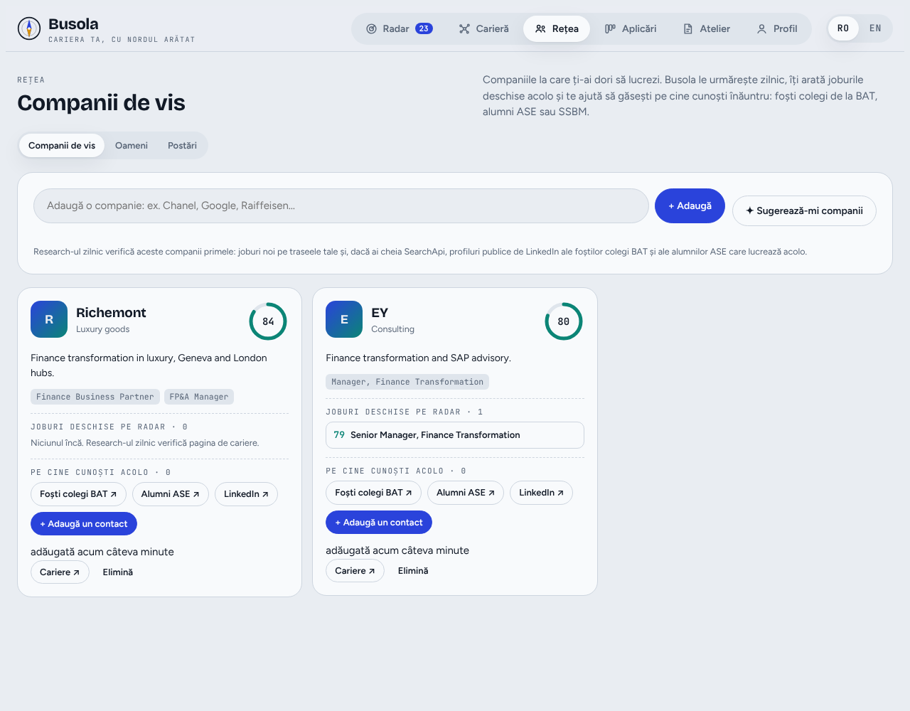
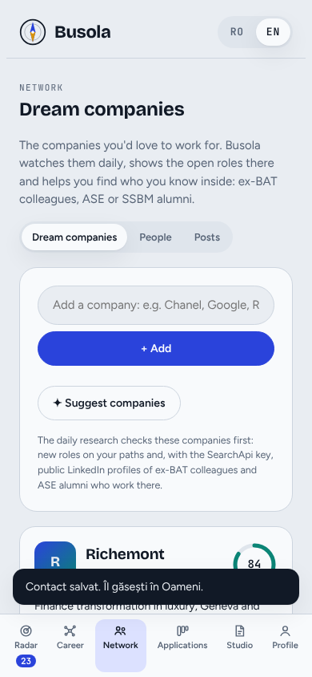

# Busola: cariera ta, cu nordul arătat

Aplicație personală de căutare și aplicare la joburi, în română și engleză, construită ca un singur fișier HTML (`index.html`).

## Ce face

- **Radar**: joburi reale din România și din străinătate, cu scor de potrivire față de profil, filtre pe regiune, domeniu și companii mari.
- **Carieră**: trasee de carieră („Rolul ideal”) și un plan de creștere cu skill-uri, certificări, MBA, cursuri, bootcamp-uri, conferințe și evenimente, plus căutarea „Întreabă Busola”.
- **Rețea**: companii de vis urmărite zilnic, contacte (foști colegi, alumni) și mesaje de cerere de recomandare; postări publice „we're hiring”.
- **Aplicări**: tablou cu etapele aplicărilor și follow-up-uri.
- **Atelier**: CV și scrisoare de intenție personalizate pe job, antrenor de interviu, dosar de companie și control de calitate al CV-ului (ATS + scanare de formulări care sună generat).
- **Profil**: încărcare CV (PDF/DOCX), preferințe, optimizare LinkedIn.

## Cum rulează

Aplicația e făcută pentru a rula ca Artifact pe claude.ai, unde primește:

- o bază de date privată (doar proprietarul o poate citi),
- funcțiile de AI (`window.claude`), folosite pentru CV-uri, scrisori, mesaje și analize,
- descărcarea fișierelor.

Pe GitHub Pages (https://madalinas94.github.io/skills-getting-started-with-github-copilot/busola/) aplicația merge și singură:

- **Datele** stau doar în browser (`localStorage`). Profilul, planurile și companiile de vis se mută cu Profil → „Descarcă datele mele” pe claude.ai și „Încarcă fișierul cu date” pe GitHub.
- **Funcțiile de AI** folosesc o cheie API Anthropic proprie, introdusă în Profil. Cheia rămâne doar în browser și cererile merg direct la `api.anthropic.com`.
- **Joburile noi** vin din `data/jobs.json`, pe care research-ul zilnic îl actualizează în fiecare dimineață.

Datele personale (CV, aplicări, contacte, profil) **nu** sunt în acest repository. `data/jobs.json` conține doar anunțurile publice, fără scorurile și comentariile legate de profil.

## Capturi

